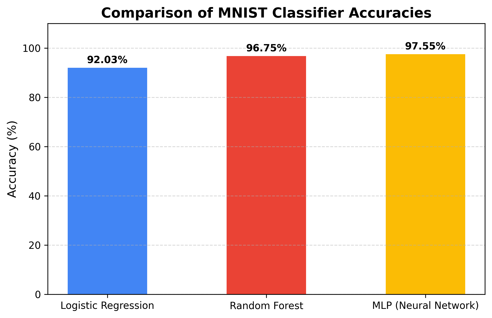
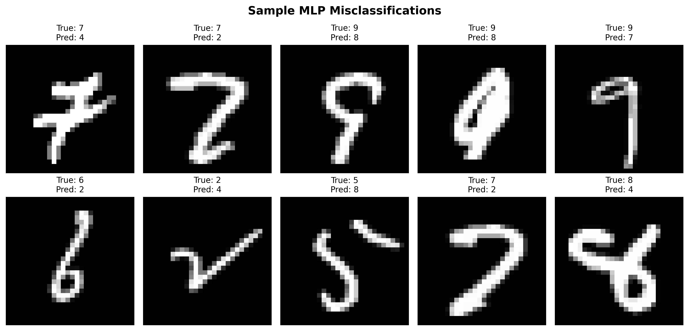
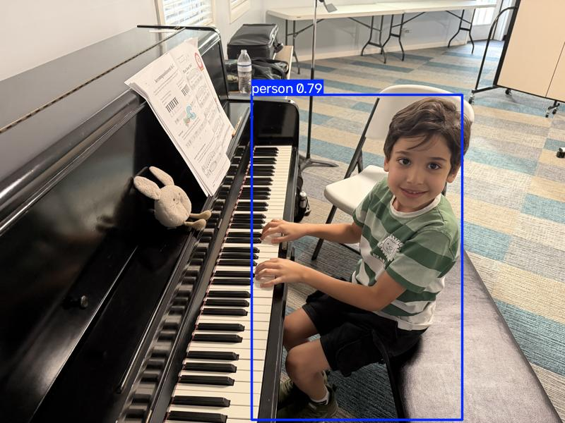

# NANO706 Assignment 2 - Part 2: Deep Learning & Computer Vision

This repository contains the implementation of Assignment 2 (Part 2) focusing on image classification and object detection tasks using state-of-the-art machine learning models, convolutional neural networks, and pre-trained deep learning vision architectures.

---

## Table of Contents
- [Part 1: MNIST Digit Classification](#part-1-mnist-digit-classification)
  - [Models Trained](#models-trained)
  - [Results & Performance Metrics](#results--performance-metrics)
  - [Error Analysis](#error-analysis)
- [Part 2: Object Detection with YOLOv5](#part-2-object-detection-with-yolov5)
  - [Implementation Strategy](#implementation-strategy)

---

## Part 1: MNIST Digit Classification

We benchmarked three different machine learning approaches on the hand-written MNIST digit classification dataset. The data was split into training (80%) and testing (20%) sets. Features were normalized to a range of `[0, 1]` to optimize optimizer convergence.

### Models Trained
1. **Logistic Regression**: A baseline linear classifier with `max_iter=1000`.
2. **Random Forest**: An ensemble method using 100 decision trees.
3. **Multi-Layer Perceptron (MLP)**: A feedforward neural network trained with standard backpropagation.

### Results & Performance Metrics

| Classification Model | Testing Accuracy |
| :--- | :---: |
| Logistic Regression | **92.03%** |
| Random Forest | **96.75%** |
| **MLP (Neural Network)** | **97.55%** |

### Performance Comparison

<!-- Upload accuracy_comparison.png to your repository and adjust the path below -->

### Error Analysis
While the MLP model achieved the highest accuracy (**97.55%**), it still produced **343 misclassifications** out of 14,000 testing instances. Below is a sample grid showing common misclassifications (true targets versus predicted labels) to help diagnose why certain edge cases failed.

<!-- Upload mlp_misclassifications.png to your repository and adjust the path below -->

---

## Part 2: Object Detection with YOLOv5

We leveraged a pre-trained **YOLOv5s (small)** model to perform person-filtered object detection on a custom personal photo.

### Implementation Strategy
- **HEIF/HEIC Image Format Compatibility**: Configured `pillow-heif` to automatically parse raw iOS-native HEIC media files (`Fareed.jpg`).
- **Dimension Regularization**: Downscaled high-resolution sensor images to standard $800 \times 600$ resolution to optimize GPU/CPU memory footprints and prevent execution timeouts.
- **Class-Filtered Inference**: Customized YOLOv5's backend properties to limit non-maximum suppression (NMS) outputs to class ID `0` (`person`). This strictly isolates human presence while discarding irrelevant background objects.

### Detection Output

<!-- Upload fareed_detected.jpg to your repository and adjust the path below -->

---

